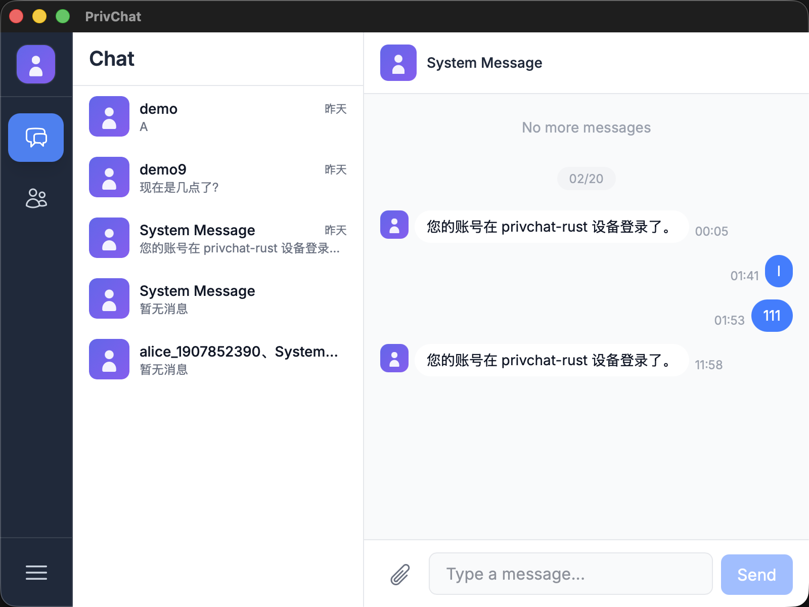

# PrivChat Desktop

`PrivChat Desktop` 是专为 PrivChat 打造的全新桌面 IM 客户端（Tauri + Vue 3 + Rust）。

## 当前状态

- 应用名：`PrivChat`
- 包标识：`im.privchat.desktop`
- Tauri crate：`privchat-desktop`
- Rust SDK：对接 `privchat-rust/crates/privchat-sdk-ffi`
- 传输 TLS：统一走 `rustls`

## 界面预览

### Welcome


### Chat



## 快速启动

### 1. 环境要求

- Node.js 18+
- npm 9+
- Rust stable
- Tauri v2 构建环境（macOS 需要 Xcode Command Line Tools）

### 2. 安装依赖

```bash
npm install
```

### 3. 启动开发模式

```bash
npm run tauri dev
```

默认连接地址为 `tcp://127.0.0.1:9001`。

可通过环境变量覆盖：

```bash
PRIVCHAT_SERVER_URL=tcp://127.0.0.1:9001 npm run tauri dev
```

## 演示账号

- `demo / 123456`
- `admin / 123123`

## 打包构建

```bash
npm run build
npm run tauri build
```

## 和 privchat-rust 的关系

- 桌面端通过 `src-tauri` 调用 `privchat-sdk-ffi`
- 会话/消息/联系人等核心数据流由 `privchat-rust` 提供
- 消息发送链路支持 `generate_local_message_id()` optimistic 流程

## 验证与测试

### SDK 单元测试

```bash
cargo test -p privchat-sdk
```

### 三账号集成回归（含 PTS 严格校验）

```bash
cargo run
```

该回归包含：
- 全量 phase 流程
- 3 账号离线/上线两轮的 PTS 稳定性检查

### 桌面端 Rust 层编译检查

```bash
cargo check
```

## 常见问题

### 1. Sled 锁冲突（`could not acquire lock`）

通常是同一数据目录下有多个实例同时运行。

处理方式：
- 先关闭所有 `PrivChat` 进程
- 只保留一个实例再启动

### 2. 白屏或前端资源异常

按顺序执行：

```bash
npm run build
npm run tauri dev
```

### 3. 登录后会话未更新

先确认：
- 服务端可用
- `PRIVCHAT_SERVER_URL` 指向正确地址
- 当前账号在服务端确实有会话/好友数据

## 目录说明

- `src/`：Vue 前端
- `src-tauri/`：Tauri/Rust 桥接层
- `src-tauri/src/commands.rs`：前后端命令入口
- `src-tauri/src/privchat_state.rs`：SDK 生命周期与状态管理
- `src-tauri/src/bin/privchat_probe.rs`：SDK 连通性/登录探针

## 定位

PrivChat Desktop 是 PrivChat 官方桌面客户端，围绕 PrivChat 协议、SDK 与服务端能力持续演进。
